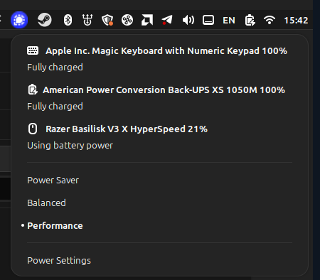

# basilisk-battery

[](https://github.com/arkady-emelyanov/basilisk-battery/actions/workflows/ci.yml)

Show the battery level of a Razer Basilisk V3 X HyperSpeed mouse in your desktop's power applet on Linux, next to your other wireless devices. No Razer Synapse or OpenRazer needed.

<p align="center">
  <br>
  <sub><b>Cinnamon power applet</b>: the mouse listed with its own icon, next to a keyboard and a UPS.</sub>
</p>

The mouse only reports its battery through Razer's vendor protocol, which desktop tools don't understand. basilisk-battery reads it from the 2.4 GHz receiver and republishes it as a standard HID battery, so the kernel exposes it as a `power_supply` and UPower lists it as a mouse. Anything that uses UPower picks it up: the Cinnamon, GNOME and KDE power applets, `upower -d`, and so on.

## Supported hardware

| Device | USB ID | Status |
|---|---|---|
| Basilisk V3 X HyperSpeed, 2.4 GHz receiver | `1532:00b9` | Tested |
| Basilisk V3 X HyperSpeed, Bluetooth | | Not needed: over Bluetooth the mouse reports its battery itself and UPower already shows it |
| Other Razer mice | | Not supported |

`lsusb -d 1532:` shows which one you have.

## Install

Download the static binary for your machine from the [latest release](https://github.com/arkady-emelyanov/basilisk-battery/releases/latest) and run its installer:

```
curl -Lo /tmp/basilisk-battery https://github.com/arkady-emelyanov/basilisk-battery/releases/latest/download/basilisk-battery-$(uname -m)-linux
chmod +x /tmp/basilisk-battery
/tmp/basilisk-battery install
```

Builds are available for `x86_64` and `aarch64`; each has a `.sha256` file next to it. To build from source instead:

```
cargo build --release --target x86_64-unknown-linux-musl
target/x86_64-unknown-linux-musl/release/basilisk-battery install
```

The mouse appears in the power applet a few seconds later, as long as it's switched on.

### What the installer does, and why it needs root

`install` shows what it is about to write and asks for your password once (through `pkexec`, or `sudo` if `pkexec` isn't available). It then, as root:

- copies the binary to `/usr/local/bin/basilisk-battery`;
- writes `/etc/systemd/system/basilisk-battery.service`, then enables and starts it;
- writes `/etc/udev/rules.d/60-basilisk-battery.rules`, which tags the virtual battery's input node as a mouse so UPower shows the right icon and type.

The service runs as root because it needs two devices that only root can use: the receiver's `/dev/hidrawN` node, to ask the mouse for its battery level, and `/dev/uhid`, to create the virtual battery. Granting `/dev/uhid` to a user account instead would let any program running as that user create fake keyboards, so it stays root-only. The service is sandboxed: it can't touch any other device, the network, or your home directory.

`basilisk-battery uninstall` stops the service and removes all three files.

## Use

- `sudo basilisk-battery status` prints the current level, e.g. `85%`.
- `journalctl -u basilisk-battery` shows level changes and when the mouse comes and goes.
- `upower -d` lists it as `Razer Basilisk V3 X HyperSpeed`, type `mouse`.

The service checks the mouse every 60 seconds; an AA battery drains slowly, so that is plenty. The mouse stops answering a few minutes after you last move it, so while it sleeps the applet keeps showing the last level it reported. If it stays silent for an hour (most likely switched off), or the receiver is unplugged, the entry disappears from the applet; it comes back within a minute of the mouse waking up.

## How it works

1. Every 60 seconds it sends one read command, battery level (class `0x07`, command `0x80`), as a 90-byte HID feature report to the receiver's interface 0, which relays it to the mouse over the air, and reads the answer back. The mouse reports the level on a 0–255 scale, which is converted to a percentage. It runs on an AA battery, so there is no charging state.
2. It creates a virtual HID device through `/dev/uhid` whose report descriptor has a standard Battery Strength usage, and sends the value as input reports.
3. The kernel's `hid-input` turns that into `/sys/class/power_supply/hid-basilisk-v3-x-hyperspeed-battery`, which UPower picks up like any Bluetooth mouse battery.

The protocol is the one [OpenRazer](https://github.com/openrazer/openrazer) uses for Razer mice. basilisk-battery only ever sends read commands: it doesn't change any mouse setting.

## Develop

```
cargo test
cargo build --release
sudo target/release/basilisk-battery status
sudo target/release/basilisk-battery run --interval 10
```
